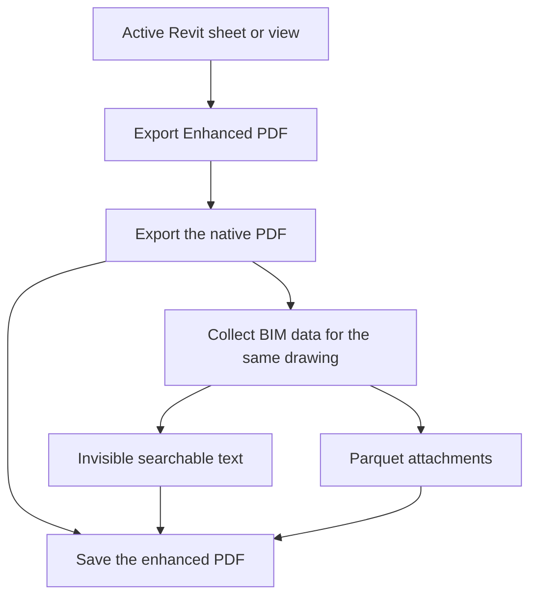

# Enhanced PDFs for Revit

Export a Revit drawing with its BIM data inside the PDF. The add-in uses Revit's native PDF export settings and adds an invisible, searchable text layer plus Apache Parquet attachments. The drawing and its model data travel in one file. Inspired by the [Speckle enhanced PDF demonstration](https://www.linkedin.com/feed/update/urn:li:activity:7524888428274950144/).



## Install in Revit 2025

In the Windows guest, close Revit and run the following from the repository root in PowerShell. A source build requires the .NET 8 SDK or later and a local Revit 2025 installation.

```powershell
.\scripts\Install-RevitAddin.ps1
```

Use `-RevitPath` for a non-default Revit installation. Use `-BuildDirectory` to install an existing Release build without the SDK. The installer writes a per-user Revit add-in manifest and copies the build to the guest's local disk. On launch, Revit may prompt you to load the unsigned local build. Choose **Load Once** for the current session. You can save exported PDFs directly to your Mac through a Parallels shared folder.

## Export and inspect

1. Open the printable view or sheet in a Revit project and click its drawing canvas.
2. Select **Add-Ins → Enhanced PDFs → Export Enhanced PDF**.
3. Save the PDF. Use the viewer's search or extract the page text to find drawing names, element IDs, and common properties. Open the PDF attachments to read complete instance and type parameters exposed by Revit.

For example, ask a PDF reader that extracts text: **“What Fire Rating values are assigned to the exterior walls on this drawing? Cite the Revit element IDs and distinguish blank ratings.”** The text layer includes each wall's Revit Function and Fire Rating, with a summary per view. A blank Fire Rating is reported as unspecified.

### Embedded tables

| Attachment | Rows |
| --- | --- |
| `drawings.parquet` | The exported sheet or view and each placed view or schedule, with names, placement identifiers, revision, model, and export metadata |
| `elements.parquet` | Elements with Revit element IDs, unique IDs, categories, types, and common properties |
| `appearances.parquet` | Element membership per drawing or placed view |
| `parameters.parquet` | Populated instance and type parameters, including Revit display values and raw typed values |
| `schedule-cells.parquet` | Text Revit exposes for sheet schedules, when present |

Join appearances to drawings on `DrawingId` and to elements on `ElementKey`. Join instance parameters using `OwnerKey = ElementKey` and type parameters using `OwnerKey = TypeKey`. Use the view and model identifiers alongside element IDs when checking linked elements. Share the enhanced PDF only with recipients who should receive its embedded model properties.

For plans, elevations, sections, details, and 3D views, membership is collected from Revit's drawing callbacks. Sheet-owned elements and schedule cells use the corresponding Revit APIs. Elements from view types such as legends and drafting views use their view-owned element lists. View data follows Revit's custom exporter, so its callbacks can differ from the PDF engine where printing hides annotations or rasterizes effects. Split schedules currently include data for the full schedule. Linked schedule rows contribute displayed cell text. Imported CAD or raster graphics carry the Revit container's properties when it is exposed.

## Verify a PDF

Export the same active view with Revit's **File → Export → PDF** using the same active PDF settings. Compare the render, read the Parquet tables, and verify the PDF text layer using independent readers.

```sh
uv run --script scripts/verify_pdf.py enhanced.pdf --native revit-native.pdf
```

For an exact pixel comparison, use the native PDF from the same export run. Revit can print the export time in the title block, which changes between independent exports.

### Snowdon Towers verification

In Revit 2025.4, open sheet **A101 – First Floor Plan** in Autodesk's Snowdon Towers architectural sample. In its placed **L1** plan, use **Manage → Select by ID** for wall `676281`. Its type properties show **Function** as **Exterior** and **Fire Rating** as **2 HR**.

```sh
uv run --script scripts/verify_pdf.py enhanced.pdf --native revit-native.pdf --wall-id 676281 --rating '2 HR'
```

In a test copy, use **Hide Elements** on that wall in **L1** and export **A101** again. The next PDF should exclude wall `676281` from its searchable text and Parquet data.

```sh
uv run --script scripts/verify_pdf.py hidden-wall.pdf --excluded-id 676281
```
